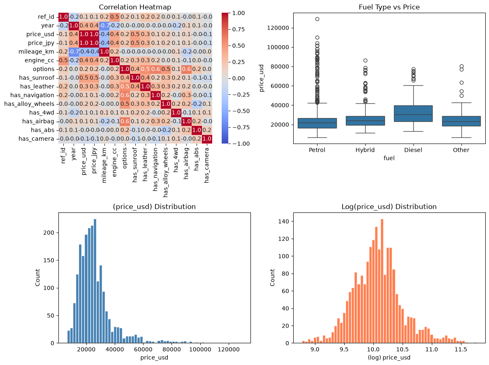

# Import Cars Price Prediction

This project uses data scrapped from SBT japan to build a machine learning model capable of predicting the market prices of used Japanese vehicles based on their specifications.The application is built with **Python**, **Flask**, **Scikit-learn**, and **XGBoost**, and provides predictions through a simple web interface.

## The project follows a complete machine learning workflow:
- Exploratory Data Analysis (EDA)
- Data Cleaning & Feature Engineering
- Data Preprocessing
- Model Training
- Model Evaluation
- Model Serialization for Deployment

The final model is built using XGBoost Regressor and integrated into a reusable Scikit-Learn pipeline.

## Project Structure

```
project/
    │
    |---- data/
    │       |-- japan_cars.csv
    │
    |---- models/
    │       |-- price_pipeline.pkl
    │
    |---- notebooks/
    |       |-- car_import.ipynb
    |       |-- scrapping.ipynb 
    |
    |---- src/
    │       |-- flask_api.py
    │       |-- preprocess.py
    │       |-- train.py
    │       |-- evaluate.py
    │       |-- templates/
    │           |-- index.html
    │
    |---- requirements.txt
    |---- README.md
```

## Model Pipeline

### Numerical Features

* Year
* Mileage (km)
* Engine Capacity (cc)
* Number of Options
* Sunroof
* Leather Seats
* Navigation
* Alloy Wheels
* 4WD
* Airbags
* ABS
* Reverse Camera

### Categorical Features

* Fuel Type
* Transmission
* Vehicle Type

### High cardinality Features

* Vehicle Name
* Chassis Code 

### Preprocessing

#### Feature Engineering

* Missing value imputation using the **median** strategy for numerical features.
* Missing value imputation using the **most frequent** strategy for categorical features.
* One-Hot Encoding for categorical features.
* Target Encoding for high-cardinality features.

### TARGET (y)
Due to outliers the target variable was log-transformed during training using `np.log1p()` and converted back to the original price scale during prediction using `np.expm1()`.



## Model

The prediction model is built using **XGBoost Regressor**.

```python
XGBRegressor(
    random_state=42,
    n_estimators=500,
    learning_rate=0.05,
    max_depth=6,
    subsample=0.8,
    colsample_bytree=0.8
)
```

## Model Performance

Performance evaluated on the test dataset.

| Metric   |         Score |
| -------- | ------------: |
| MAE      | **$2,417.19** |
| RMSE     | **$4,791.69** |
| R² Score |    **0.9227** |


## Features

* Predicts used car prices in USD.
* Flask web interface for entering vehicle details.
* Machine learning pipeline using Scikit-learn.
* XGBoost regression model.
* Automatic preprocessing of numerical and categorical features.
* Target Encoding for high-cardinality categorical variables.
* One-Hot Encoding for categorical variables.
* Automatic calculation of vehicle option count from selected features.
* Log-transformed target variable for improved model performance.
* End-to-end prediction pipeline saved with Joblib.

## Technologies Used

* Python
* Flask
* Pandas
* NumPy
* Scikit-learn
* XGBoost
* Joblib
* HTML & CSS


